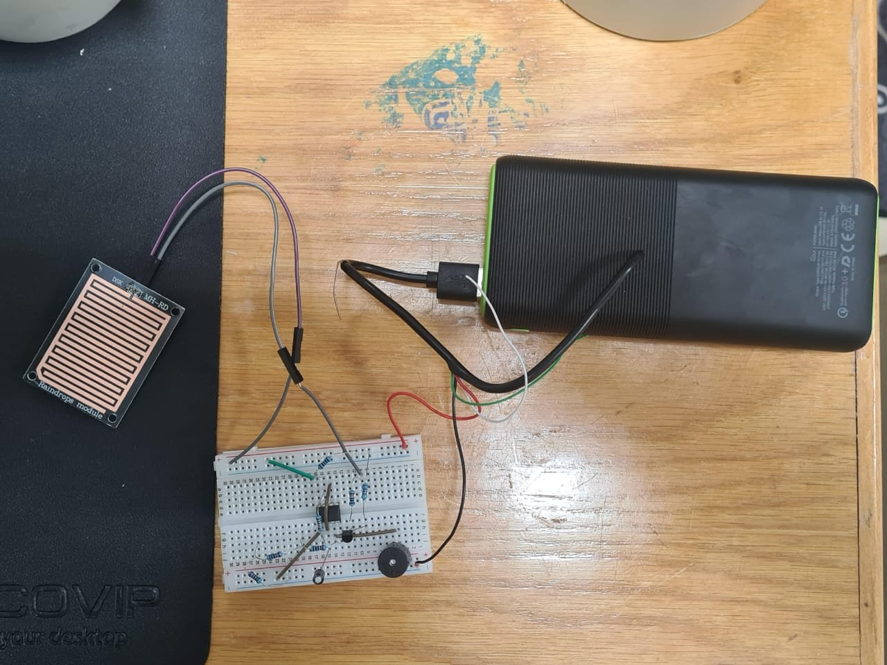
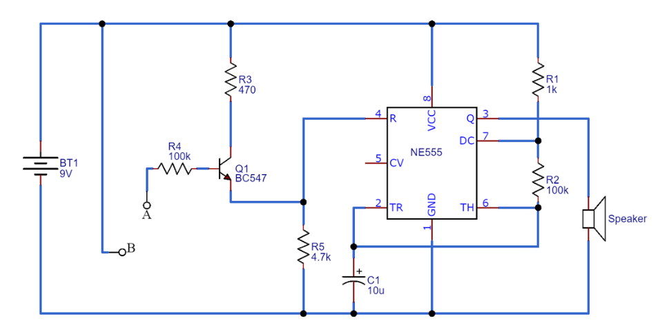
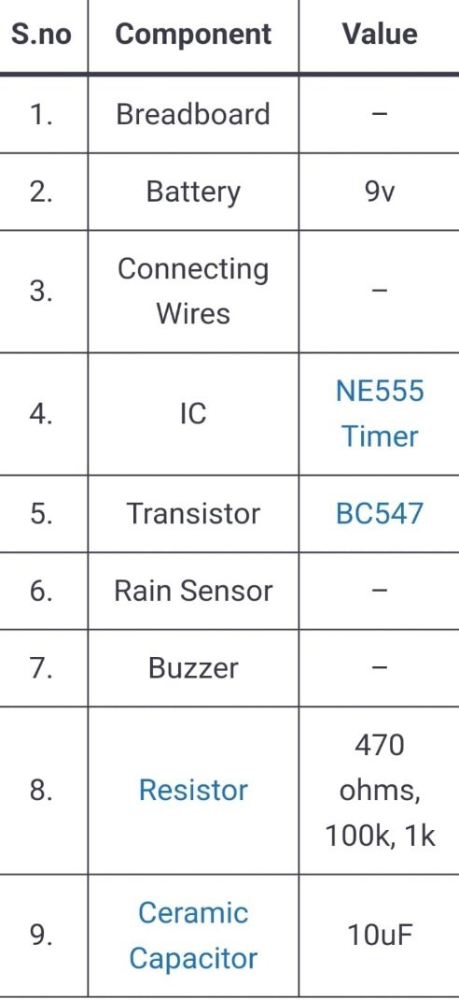

# Rain Detector Alarm (555 Timer + BC547)

> Electronics (EE 3481) design project · team project · NI Multisim

A low-cost **rain alarm**. When raindrops bridge the tracks of a rain-sensor board, a transistor switch enables a **555 timer** in astable mode, and the timer sounds a speaker or buzzer. It is useful for clothes lines, windows, irrigation control and similar uses.

| Prototype | Schematic |
|---|---|
|  |  |

## How it works
1. **Sensing.** The rain board's comb-shaped tracks are open when dry. Water conducts between them.
2. **Switching.** Sensor terminal B connects to +9 V. When it is wet, current flows from terminal A through R4 (100 kΩ) into the base of the **BC547**. The transistor then pulls the 555's RESET pin (4) high against the R5 (4.7 kΩ) pull-down, which enables the timer.
3. **Alarm.** The **NE555** runs as an astable oscillator. R1 and R2 (1 kΩ / 100 kΩ) with C1 (10 µF) set the tone frequency that drives the speaker.
4. **Supply.** A 9 V battery.

## Simulation
The circuit was designed and simulated in NI Multisim: [`simulation/Design1.ms14`](simulation/Design1.ms14).

## Lessons learned
- The sensor picked up noise, which was fixed with better grounding and filtering.
- Sensitivity changes with temperature and humidity, so the circuit was calibrated under different conditions.
- Idle power use was reduced to extend battery life.
